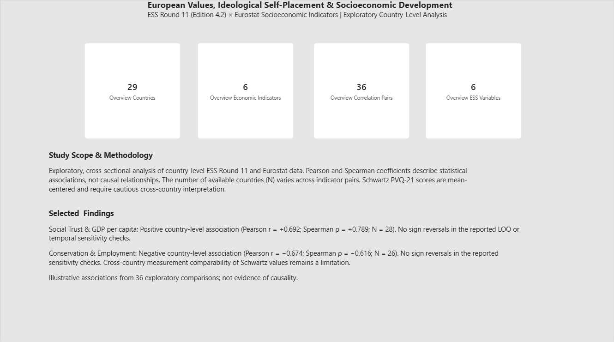
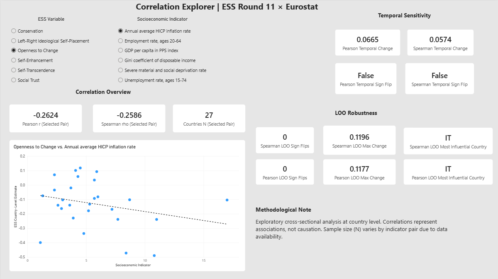

# European Values, Ideological Self-Placement & Socioeconomic Development

**ESS Round 11 (Edition 4.2) × Eurostat | Python · MySQL · Power BI**

An exploratory, cross-sectional research and data analytics project investigating country-level associations between **generalized social trust**, **ideological self-placement**, **Schwartz human values**, and **socioeconomic conditions** across European societies.

The project demonstrates an end-to-end analytical workflow combining:

- Data Engineering
- Data Cleaning and Validation
- Survey Data Processing
- Statistical Analysis
- Relational Database Modelling
- Business Intelligence
- Scientific Documentation and Reproducibility

The technical architecture integrates **Python, ESS and Eurostat data sources, MySQL, and Power BI**.

> **Research boundary:** The primary statistical unit is the country. The reported associations are exploratory and descriptive, not causal. Country-level correlations must not be interpreted as individual-level relationships or generalized automatically to all European countries.

**Scientific documentation:** [Results (English)](docs/scientific_results_v1_en.md) · [Results (Română)](docs/scientific_results_v1_ro.md) · [Discussion (English)](docs/scientific_discussion_v1_en.md) · [Discussion (Română)](docs/scientific_discussion_v1_ro.md) · [Survey Weighting Policy (English / Română)](docs/weighting_policy_v1.md)

**Repository access:** The ESS Data Archive at Sikt has clarified the applicable ESS data licence. Public redistribution is subject to the applicable data licensing conditions.

---

## 1. Project Overview

| Component | V1 Implementation |
|---|---|
| Survey source | European Social Survey (ESS) Round 11, Edition 4.2 |
| Socioeconomic source | Eurostat API |
| ESS analytical sample | 49,210 respondents |
| Countries | 29 |
| ESS analytical variables | 6 |
| Eurostat indicators | 6 |
| Baseline correlations | 36 Pearson/Spearman pairs |
| Countries per correlation | 25–28 |
| Sensitivity analyses | Leave-One-Country-Out, temporal sensitivity, targeted Schwartz exclusions |
| Database | MySQL, 8 analytical tables |
| Dashboard | Power BI Desktop, 5 report pages + 1 hidden QA page |
| Primary language | Python |
| Statistical libraries | pandas, NumPy, SciPy |
| Visualization libraries | Matplotlib, adjustText |

The project combines a reproducibility-oriented engineering workflow with an explicitly limited scientific research design.

Its main contribution is the integration and validation of ESS–Eurostat country-level data, followed by systematic examination of the sensitivity of observed statistical associations.

---

## 2. Research Objectives

The main research question is:

**How are socioeconomic conditions associated with generalized social trust, ideological self-placement, and human values across the European countries included in ESS Round 11?**

The V1 analysis focuses on four research dimensions:

1. Generalized Social Trust
2. Schwartz Human Values
3. Ideological Self-Placement
4. Socioeconomic Conditions

The analysis examines:

- Differences in aggregated survey indicators across countries.
- The direction and magnitude of cross-country associations.
- Agreement between Pearson and Spearman correlations.
- Sensitivity to the removal of individual countries.
- Sensitivity to alternative socioeconomic context years.
- Sensitivity of selected Schwartz associations to country exclusions.
- Data coverage and missing-value patterns.

### Research scope

V1 is a **cross-sectional, exploratory, country-level study** using a single ESS round.

It does not estimate:

- Causal effects.
- Longitudinal effects across ESS rounds.
- Individual-level relationships from country-level correlations.
- Multilevel regression models.
- Confirmatory statistical hypotheses.

More advanced statistical approaches may be considered in future project versions, but they are not presented as completed V1 analyses.

---

## 3. Data Sources

### 3.1. European Social Survey

The primary social survey source is:

**European Social Survey Round 11 — Integrated File, Edition 4.2**

Official dataset:

https://doi.org/10.21338/ess11e04_2

The analytical sample includes:

- 49,210 respondents.
- 29 countries.
- Individual-level survey responses subsequently aggregated into country-level estimates.

The ESS dataset provides the variables needed to measure:

- Ideological self-placement.
- Generalized social trust.
- Human values.
- Survey weighting and sampling-design information.
- Relevant country and fieldwork metadata.

Original ESS special missing-value codes are explicitly handled during processing.

Original ESS microdata are retained locally and are not redistributed through this repository.

### 3.2. Eurostat

Socioeconomic data are obtained using Eurostat datasets and API resources.

The analysis uses six indicators.

| Indicator | Eurostat Dataset |
|---|---|
| GDP per capita in PPS, EU27_2020 = 100 | `tec00114` |
| Employment rate, ages 20–64 | `lfsi_emp_a` |
| Unemployment rate, ages 15–74 | `une_rt_a` |
| Gini coefficient of equivalised disposable income | `ilc_di12` |
| Severe material and social deprivation rate | `ilc_mdsd11` |
| Annual average HICP inflation rate | `tec00118` |

Official Eurostat Data Browser:

https://ec.europa.eu/eurostat/databrowser/

Indicator definitions and extraction configurations are documented in:

[`config/eurostat_indicators_v1.csv`](config/eurostat_indicators_v1.csv)

The data pipeline preserves relevant source information, including dataset identifiers, reference years, units, retrieval metadata, and missing-value information.

Reuse of these data is subject to applicable Eurostat conditions and exceptions.

---

## 4. Project Architecture

The project follows a modular analytical pipeline.

```text
ESS Round 11                  Eurostat API
      |                            |
      +-------------+--------------+
                    |
                    v
          Python Data Ingestion
                    |
                    v
        Raw Data and Source Metadata
                    |
                    v
           Data Profiling
                    |
                    v
        Cleaning and Validation
                    |
                    v
         ESS Survey Weighting
                    |
                    v
        Schwartz Human Values
                    |
                    v
        Country-Level Aggregation
                    |
                    v
       Eurostat Temporal Alignment
                    |
                    v
         Socioeconomic Integration
                    |
                    v
           Statistical Analysis
         Pearson and Spearman
                    |
                    v
          Sensitivity Analyses
                    |
                    v
         Validated Analytical Data
                    |
                    v
            MySQL Database
                    |
                    v
           Power BI / DAX
                    |
                    v
          Interactive Dashboard
```

The architecture separates data collection, analytical transformation, validation, statistical processing, relational storage, and reporting.

The implementation is organized into numbered Python and SQL scripts.

It is not currently packaged as a single-command production pipeline.

---

## 5. Data Processing and Methodology

### 5.1. Data ingestion

Python scripts handle source-data ingestion, transformation, and validation.

The workflow includes:

- ESS data ingestion.
- Eurostat API extraction.
- Validation of country mappings.
- Validation of indicator definitions.
- Fieldwork metadata processing.
- Missing-value handling.
- Survey weighting.
- Human Values scoring.
- Temporal alignment.
- Country-level integration.
- Statistical calculations.
- Independent output validation.

Original raw data are preserved locally.

### 5.2. Ideological self-placement

Ideological self-placement is measured using the ESS variable:

`lrscale`

The original continuous scale ranges from:

- `0` — Left
- `10` — Right

The continuous measure is retained for the primary country-level analysis.

Project-defined descriptive categories may be used where appropriate, but these are not treated as official ESS classifications.

### 5.3. Generalized Social Trust

Generalized Social Trust is based on three ESS variables:

- `ppltrst`
- `pplfair`
- `pplhlp`

The project constructs the documented analytical Social Trust measure using valid responses to these items.

The country-level estimates are calculated using ESS survey weights.

### 5.4. Schwartz Human Values

The Human Values component follows Schwartz's theoretical framework.

Four higher-order value dimensions are analyzed:

| Dimension | Broad Motivational Orientation |
|---|---|
| Openness to Change | Autonomy, independence, novelty and stimulation |
| Conservation | Security, conformity and tradition |
| Self-Transcendence | Concern for others and universalism |
| Self-Enhancement | Achievement and power |

Scores are calculated from the ESS PVQ-21 items.

The implemented scoring procedure includes:

- The documented item transformations.
- Respondent-level mean-centering (MRAT).
- Complete-case requirements for all 21 PVQ items.
- Aggregation into higher-order value dimensions.
- Survey-weighted country estimates.

The resulting scores represent **relative value priorities** rather than absolute endorsement levels.

Because the measures are respondent-mean-centered, the value dimensions are not mathematically independent.

Cross-country comparisons also require caution regarding measurement comparability.

---

## 6. Survey Weighting

ESS respondent-level data originate from complex probability samples.

The principal weight used for descriptive country-level estimates is:

`anweight`

The standard ESS relationship is:

`anweight = pspwght × pweight`

The project validates this relationship using the analytical sample.

Survey-weighted estimates include:

- Mean ideological self-placement.
- Ideological descriptive shares.
- Generalized Social Trust.
- Schwartz Human Values dimensions.

Sampling-design variables, including `psu` and `stratum`, are used in the separately implemented uncertainty calculations for relevant survey aggregates.

### Country-level correlations

After ESS responses are aggregated into country-level estimates, the statistical unit changes from the respondent to the country.

Therefore, respondent survey weights are not mechanically applied again to the country-level Pearson and Spearman correlations.

Each available country contributes equally to the baseline cross-country correlations.

For details, see:

[Survey Weighting Policy V1](docs/weighting_policy_v1.md)

---

## 7. Temporal Alignment

ESS fieldwork periods do not necessarily correspond to a single calendar year.

The project uses country-level fieldwork metadata to identify the dominant fieldwork year.

Eurostat indicators are aligned using predefined temporal rules.

The procedure includes:

- Identification of country-specific dominant fieldwork years.
- Validation of temporal alignment targets.
- Explicit handling of missing economic observations.
- Documentation of requested and available reference years.
- Alternative-year sensitivity analyses.

A documented **+1 reference-year offset** is applied for the Gini indicator.

Economic observations are not silently replaced with values from nearby years.

The analysis preserves missing observations where the required reference-year data are unavailable.

---

## 8. Country-Level Integration

The integrated analytical data contain six socioeconomic indicators across 29 countries.

This gives:

**29 × 6 = 174 expected country–indicator observations.**

The validated economic-data coverage is:

| Category | Observations |
|---|---:|
| Expected | 174 |
| Available numeric values | 158 |
| Missing values | 16 |
| Coverage | 90.80% |

Missing observations remain explicitly represented.

The data-quality procedures preserve relevant information about:

- Country.
- Indicator.
- Observation year.
- Requested year.
- Source dataset.
- Unit of measurement.
- Missing-value status.
- Temporal alignment.
- Data provenance.

This information supports both the analytical workflow and the Power BI data-quality reporting.

---

## 9. Statistical Analysis

The primary statistical analysis examines associations between:

- Six aggregated ESS variables.
- Six Eurostat socioeconomic indicators.

This produces **36 ESS–Eurostat variable pairs**.

For every pair, the project calculates:

- Pearson correlation coefficient.
- Spearman rank correlation coefficient.
- Number of available countries.
- Associated sensitivity diagnostics.

The available country count varies between **25 and 28**.

### Interpretation policy

The results are evaluated primarily through:

1. Coefficient magnitude.
2. Direction of association.
3. Pearson–Spearman agreement.
4. Available country count.
5. Leave-One-Country-Out sensitivity.
6. Temporal sensitivity.
7. Relevant country-exclusion scenarios.

The analysis does not use arbitrary robustness scores to classify relationships.

The 36 associations are treated as exploratory findings, not confirmatory hypothesis tests.

---

## 10. Selected Results

The following examples illustrate selected country-level associations.

| ESS Variable | Eurostat Indicator | Pearson r | Spearman rho | Countries |
|---|---|---:|---:|---:|
| Social Trust | GDP per capita in PPS | +0.692 | +0.789 | 28 |
| Conservation | Employment rate | -0.674 | -0.616 | 26 |
| Openness to Change | Employment rate | +0.592 | +0.607 | 26 |

Across the 36 pairs:

- Pearson and Spearman exhibited the same strict sign for 34 pairs.
- Nine pairs exhibited at least one Pearson sign reversal in the LOO analysis.
- Seven pairs exhibited at least one Spearman sign reversal in the LOO analysis.
- The temporal sensitivity analysis identified one Pearson and two Spearman sign reversals.
- The targeted Schwartz country-exclusion analyses identified no strict sign reversals.

These outcomes describe sensitivity within the scenarios evaluated.

They do not establish causal relationships or general statistical stability.

In particular, unchanged coefficients in exclusion scenarios where a country was already absent from the baseline sample do not provide independent evidence of robustness.

The complete interpretation is documented in:

- [Scientific Results V1 — English](docs/scientific_results_v1_en.md)
- [Scientific Results V1 — Română](docs/scientific_results_v1_ro.md)
- [Scientific Discussion V1 — English](docs/scientific_discussion_v1_en.md)
- [Scientific Discussion V1 — Română](docs/scientific_discussion_v1_ro.md)

The detailed numerical evidence matrix and generated statistical outputs are retained in the local project environment.

---

## 11. Sensitivity Analyses

### 11.1. Leave-One-Country-Out

The Leave-One-Country-Out (LOO) procedure recalculates each association after removing one available country at a time.

The analysis examines:

- Changes in Pearson correlations.
- Changes in Spearman correlations.
- Sign reversals.
- Maximum absolute coefficient changes.
- Dependence on individual country observations.

The LOO procedure is a descriptive sensitivity analysis.

Its coefficient ranges are not confidence intervals and do not constitute independent sample validation.

### 11.2. Temporal sensitivity

The temporal analysis examines how selected associations respond to changes in the socioeconomic context year.

Comparisons use common-country samples where applicable.

The analysis identified particularly important changes for associations involving inflation.

These results indicate sensitivity to temporal specification, not causal effects of inflation on social attitudes or values.

### 11.3. Schwartz country exclusions

The project evaluates three targeted exclusion scenarios:

- Excluding Estonia (EE).
- Excluding the United Kingdom (GB).
- Excluding both EE and GB.

These scenarios are applied to the 24 Schwartz–Eurostat relationships.

No strict Pearson or Spearman sign reversals were identified in the examined scenarios.

However, GB was present only in the relevant GDP PPS baseline samples.

Exclusion scenarios that do not actually change sample composition are not interpreted as independent robustness evidence.

These checks are also distinct from formal psychometric measurement-invariance testing.

---

## 12. MySQL Relational Data Model

The analytical database is named:

`european_values_v1`

It contains **three dimension tables and five fact tables**.

### Dimension tables

| Table | Records |
|---|---:|
| `dim_country` | 29 |
| `dim_ess_variable` | 6 |
| `dim_economic_indicator` | 6 |

### Fact tables

| Table | Records |
|---|---:|
| `fact_country_ess` | 174 |
| `fact_country_economic` | 174 |
| `fact_correlation` | 36 |
| `fact_correlation_robustness` | 36 |
| `fact_schwartz_exclusion` | 72 |

The model contains **533 records across eight analytical tables**.

The relational structure supports:

- Country-level ESS estimates.
- Economic indicator availability.
- Baseline statistical associations.
- Correlation sensitivity diagnostics.
- Schwartz exclusion scenarios.
- Analytical reporting in Power BI.

### SQL implementation

The project was implemented locally using numbered SQL scripts for:

- Database and table creation.
- Data insertion.
- Table validation.
- Analytical exports.

The tracked SQL code includes schema definitions and available validation/export logic.

Eight SQL `INSERT` scripts contain embedded analytical values and remain intentionally excluded from Git tracking.

Those scripts remain in the local development environment.

Consequently, the tracked SQL files document the database structure but do not currently provide a complete, standalone database-population workflow.

---

## 13. Power BI Dashboard

The project includes a complete Power BI Desktop report:

[`European_Values_V1.pbix`](powerbi/European_Values_V1.pbix)

The PBIX contains the analytical report, semantic model, relationships, DAX measures, and imported country-level data.

The report was developed using a local MySQL connection to:

`localhost / european_values_v1`

The Power BI model includes the eight analytical tables described above.

No respondent-level ESS microdata tables were identified in the visible model or Power Query structure during the publication review.

### Dashboard pages

#### 1. Executive Overview

Presents the overall analytical scope and selected descriptive findings.

#### 2. Correlation Explorer

Supports interactive examination of associations between ESS variables and Eurostat indicators.

Includes Pearson/Spearman results and relevant sensitivity information.

#### 3. Country Comparison

Allows comparisons across countries using ESS aggregates and socioeconomic indicators.

The visualizations preserve the distinction between the scales and units of the selected measures.

#### 4. Data Quality & Coverage

Presents economic-data availability, missing observations, and country-by-indicator coverage.

#### 5. Data Sources & Methodology

Documents source definitions, analytical boundaries, and methodological limitations.

### Internal QA page

An additional page, **QA - Measures**, is hidden from normal report navigation.

It supports internal verification of selected report measures.

### Dashboard portability

The PBIX is a Power BI Desktop file, not a publicly hosted interactive web dashboard.

A user can open a distributed PBIX in a compatible Power BI Desktop environment.

Refreshing the source data requires an appropriate MySQL database, connector configuration, and access to the necessary data.

The original local connection settings are not expected to work automatically on another computer.

### Security and distribution review

During preparation for repository distribution, the PBIX underwent local checks covering:

- The visible Power BI semantic model.
- The Power Query query list.
- Internal archive structure.
- Text-based metadata and report definitions.
- Selected patterns associated with credentials and local user paths.

The reviewed model contained eight analytical tables and no visible respondent-level microdata tables.

A scan of 79 text-based internal components identified no matches for the specified sensitive-information patterns.

These checks are risk-reduction measures, not proof that all binary model contents or metadata have been exhaustively audited.

**The PBIX contains imported analytical data, so redistribution remains subject to the applicable source-data licensing terms.**

---

## 14. Repository Structure

The repository is organized around source code, configuration, bilingual scientific documentation, and the Power BI reporting artifact.

```text
european-values-ideology-socioeconomic/
|
|-- config/
|   # Dataset mappings and indicator configuration
|
|-- docs/
|   # Scientific results, discussion, and weighting policy
|
|-- scripts/
|   # Python ingestion, transformation, analysis, validation
|
|-- sql/
|   # MySQL schema, validation, and export scripts
|
|-- powerbi/
|   `-- European_Values_V1.pbix
|
|-- README.md
|-- requirements.txt
`-- .gitignore
```

The local project environment additionally includes:

```text
data/
|-- raw/
|-- interim/
`-- processed/

outputs/
|-- tables/
|-- figures/
`-- sql_validation/

sql/
`-- 67_*_insert_*.sql

.venv/
.env
.vscode/
```

The original ESS microdata, intermediate datasets, derived data tables, generated analytical figures, database exports, and embedded-value SQL INSERT scripts are currently excluded from Git tracking.

The full PBIX is included in the repository. Its public distribution remains subject to applicable ESS and Eurostat licensing conditions.

This separation does not imply that all derived statistics or figures are legally prohibited from redistribution.

---

## 15. Python Environment and Dependencies

The Python environment used during development is based on Python 3.13.

The project dependencies are recorded in:

[`requirements.txt`](requirements.txt)

Principal libraries include:

- pandas
- NumPy
- SciPy
- PyArrow
- Requests
- python-dotenv
- Matplotlib
- adjustText

Dependencies are recorded using exact versions.

### Environment verification

The development environment was checked using:

```powershell
python -m pip check
```

The verification reported:

`No broken requirements found.`

Static checks also confirmed:

- 76 Python scripts parsed successfully.
- No syntax or encoding issues were identified.
- The eight identified external import modules were available locally.
- No hard-coded absolute paths were identified by the refined string-literal scan.
- No direct standalone Python script-filename references were identified by the corresponding static scan.

These results do not constitute a full functional test or independent reproduction of the pipeline.

---

## 16. Reproducibility

The project follows a reproducibility-oriented analytical design.

However, the repository is not currently a fully automated, single-command reproduction environment.

### General reproduction procedure

1. Create a compatible Python virtual environment.

2. Install the dependencies:

```powershell
python -m pip install -r requirements.txt
```

3. Download ESS Round 11, Edition 4.2, through the official ESS Data Portal, subject to its applicable terms of use.

4. Place the required source files in the local structure expected by the ingestion scripts.

5. Review the country mappings, Eurostat indicator configuration, and temporal alignment settings.

6. Execute the numbered Python scripts in their intended dependency order.

7. Run the corresponding validation procedures and examine the regenerated analytical outputs.

8. Create the MySQL database using the available SQL schema scripts.

9. Populate the analytical tables using locally regenerated data and the corresponding data-loading procedures.

10. Open the Power BI Desktop report and configure the data-source connection if a refresh is required.

### Current reproducibility limitations

The repository does not presently contain all data required for a complete execution.

In particular:

- Original ESS microdata must be obtained from the official source.
- Derived analytical datasets are retained locally.
- Eight data-containing SQL INSERT scripts are excluded from Git tracking.
- Some validation procedures depend on locally generated outputs.
- The original Power BI report uses a local MySQL data source.

The tracked Python and SQL code therefore documents the analytical methods and relational architecture, but the repository alone does not currently provide a fully automated database-population workflow.

**A complete independent end-to-end rerun in a clean environment has not yet been documented as successfully completed.**

---

## 17. Methodological Limitations

### Cross-sectional study design

The analysis uses a single ESS round and temporally aligned socioeconomic indicators.

It does not establish longitudinal relationships.

### Ecological inference

The country is the unit of statistical analysis.

Associations between country-level aggregates must not be translated directly into conclusions about individuals.

### Country coverage

The analytical sample contains 29 countries.

Individual correlation samples contain 25–28 countries, depending on available socioeconomic indicators.

The sample cannot automatically be generalized to all European countries.

### Schwartz measurement comparability

The Human Values scores are relative, respondent-mean-centered measures.

The project has not directly demonstrated configural, metric, or scalar measurement invariance for the specific ESS Round 11 country samples.

Therefore, cross-country Schwartz comparisons require methodological caution.

### Survey uncertainty

Country-level ESS estimates are subject to survey-sampling uncertainty.

This uncertainty is not fully propagated into the 36 cross-country correlation coefficients.

### Omitted factors

The analysis does not isolate the independent contributions of education, institutions, demographic structure, historical differences, or other potential confounders.

### Sensitivity analyses

LOO, temporal sensitivity, and targeted country exclusions examine particular analytical choices.

They do not eliminate confounding or measurement error and do not independently validate causal mechanisms.

### Multiple comparisons

The 36 relationships are exploratory.

No claim of confirmatory hypothesis testing follows merely from the direction, magnitude, or apparent stability of a correlation.

### Causality

The study does not estimate causal effects.

Observed correlations are interpreted as statistical associations only.

Detailed discussion:

[Scientific Discussion V1 — English](docs/scientific_discussion_v1_en.md)

---

## 18. Scientific Documentation

The project maintains separate documents for results, interpretation, and weighting methodology. Scientific Results and Scientific Discussion are available in English and Romanian; the Survey Weighting Policy is bilingual within one file.

### Scientific Results V1

- [English: `scientific_results_v1_en.md`](docs/scientific_results_v1_en.md)
- [Română: `scientific_results_v1_ro.md`](docs/scientific_results_v1_ro.md)

Documents:

- Baseline correlations.
- Pearson–Spearman agreement.
- LOO sensitivity.
- Temporal sensitivity.
- Schwartz country exclusions.
- Limitations of the numerical evidence.

### Scientific Discussion V1

- [English: `scientific_discussion_v1_en.md`](docs/scientific_discussion_v1_en.md)
- [Română: `scientific_discussion_v1_ro.md`](docs/scientific_discussion_v1_ro.md)

Provides:

- Literature-based interpretation.
- Theoretical context.
- Alternative explanations.
- Ecological inference limitations.
- Cross-cultural measurement considerations.
- Scientific bibliography.

### Survey Weighting Policy V1

[`weighting_policy_v1.md` — English and Română](docs/weighting_policy_v1.md)

Explains:

- ESS weight variables.
- The use of `anweight`.
- Country-level weighted estimates.
- Survey-design considerations.
- Differences between respondent-level and country-level weighting.

---

## 19. Data Licensing, Citation and Responsible Reuse

For detailed licensing and attribution requirements, see [DATA_LICENSE.md](DATA_LICENSE.md).

### European Social Survey

The project uses:

**ESS Round 11 — Integrated File, Edition 4.2**

Written clarification received from the ESS Data Archive at Sikt confirms that ESS data are licensed under [CC BY-NC-SA 4.0](https://creativecommons.org/licenses/by-nc-sa/4.0/), whereas ESS documentation is licensed under [CC BY-SA 4.0](https://creativecommons.org/licenses/by-sa/4.0/). Official ESS conditions of use: https://www.europeansocialsurvey.org/contact/disclaimer

The ESS Data Archive indicated that public distribution of aggregated country-level estimates, derived statistical results, Power BI reports and screenshots, including professional portfolio use, is permissible in principle, provided that the applicable licence conditions are respected. This guidance is retained as written correspondence and does not constitute a formal legal opinion.

**Public redistribution remains subject to applicable licensing and data-protection obligations.**

The project does not redistribute original ESS respondent-level microdata, and links to the official ESS dataset rather than mirroring the source file.

### Official ESS data citation

European Social Survey European Research Infrastructure (ESS ERIC) (2026). *ESS11 - integrated file, edition 4.2* [Data set]. Sikt - Norwegian Agency for Shared Services in Education and Research. https://doi.org/10.21338/ess11e04_2.

Derived ESS measures are identified, where relevant, as:

**Adapted from ESS Round 11, edition 4.2.**

The project is independently developed.

It is not affiliated with, sponsored by, or endorsed by ESS ERIC or Sikt.

### Eurostat

Eurostat data are reused subject to official attribution requirements and applicable exceptions.

Official source:

https://ec.europa.eu/eurostat/databrowser/

Copyright and reuse information:

https://ec.europa.eu/eurostat/help/copyright-notice

The six economic indicators are identified by their Eurostat dataset codes.

The availability of Eurostat data for reuse does not override any separate restrictions applicable to ESS-derived components.

### Scientific literature

Scientific references are documented in:

[Scientific Discussion V1 — English bibliography](docs/scientific_discussion_v1_en.md) (also available [in Romanian](docs/scientific_discussion_v1_ro.md))

The literature provides theoretical and empirical context for interpreting the project's exploratory results.

### Repository licensing

Source code, documentation, ESS data, Eurostat data, and adapted research materials may be subject to different rights and licensing conditions.

No repository-wide licence is asserted to override third-party data rights.

Any future licence for independently authored source code should be specified separately from the terms governing ESS and Eurostat data.

---

## 20. Publication and Security Review

Before publication preparation, the project underwent several local checks.

### Code and repository

- Git ignore rules were reviewed for local environment and data files.
- Candidate files were scanned using Gitleaks.
- No secrets were detected by the configured Gitleaks rules in the scan performed.
- Additional searches for selected credential, personal-path, and e-mail patterns returned no matches.
- Python syntax and import availability were checked.
- SQL structure and selected potentially destructive operations were inspected.

### Data and Power BI

- The Power BI model contains eight analytical tables.
- The visible Power Query model contains eight corresponding queries.
- No respondent-level ESS microdata tables were identified in those views.
- Selected PBIX metadata and report-definition components were scanned for sensitive patterns.
- The full data model remains an imported analytical-data container.
- Original ESS microdata remain excluded from Git.
- Derived data exports and data-containing SQL INSERT scripts remain intentionally excluded from Git tracking.

These are risk-reduction controls, not absolute guarantees that no sensitive information exists.

Publication of data-containing artifacts must also satisfy applicable licensing obligations.

---

## 21. Project Status

**Version:** V1.0

### Implemented locally

- ESS Round 11 ingestion and processing.
- Eurostat API data extraction.
- ESS survey weighting and validation.
- Schwartz Human Values scoring.
- Country-level aggregation.
- Temporal alignment.
- Socioeconomic data integration.
- Data-quality validation.
- Pearson and Spearman correlations.
- LOO sensitivity analysis.
- Temporal sensitivity analysis.
- Targeted Schwartz country-exclusion analysis.
- Eight-table MySQL analytical model.
- Five-page Power BI dashboard.
- Scientific results and literature-based discussion.

### Repository preparation

- ESS data licensing has been clarified by the ESS Data Archive at Sikt. Public redistribution is subject to applicable source-data licensing conditions.

- Python scripts have undergone static syntax and import checks.
- SQL schema and validation scripts have undergone structural review.
- Python dependencies have been updated.
- Sensitive local configuration and raw data are excluded.
- Derived analytical exports and data-containing SQL INSERT scripts are withheld.
- The complete Power BI PBIX is retained in the repository. Public distribution is subject to applicable source-data licensing conditions.
- Complete independent clean-environment reproduction remains unverified.

The project does not claim causal inference, proven measurement invariance across the analyzed countries, or a fully automated production deployment.

---

## 22. Future Development

Potential future extensions include:

- A clearer automated pipeline orchestration layer.
- Independent clean-environment reproduction tests.
- More comprehensive data-quality monitoring.
- Extended documentation of Eurostat indicator provenance.
- Analysis of additional ESS rounds.
- Longitudinal comparative analyses.
- Formal measurement-invariance assessment.
- Multilevel statistical modelling where methodologically justified.
- Improved deployment and sharing of interactive analytical reports.

These are future development directions, not completed features of V1.

## Power BI Dashboard Preview

The Power BI report provides an interactive, country-level exploration of European social values and socioeconomic indicators, including correlation analysis, robustness assessment, country comparisons, and data-quality monitoring.

### Download the Power BI Report

[Download Power BI Dashboard (.pbix)](https://github.com/osaci-cosmin/european-values-socioeconomic-indicators/raw/main/powerbi/European_Values_V1.pbix)

**Requirements:** Microsoft Power BI Desktop.

The report contains imported analytical data and can be explored without connecting to the original MySQL database. Refreshing the data requires additional database configuration.

Data reuse is subject to the conditions described in [DATA_LICENSE.md](DATA_LICENSE.md).

### Executive Overview



### Correlation Explorer



### Additional Dashboard Pages

- [Country Comparison](powerbi/screenshots/03_country_comparison.png)
- [Data Quality & Coverage](powerbi/screenshots/04_data_quality_overview.png)
- [Data Availability Matrix](powerbi/screenshots/04_data_quality_matrix.png)
- [Data Sources & Methodology](powerbi/screenshots/05_data_sources_methodology.png)

The visualizations present exploratory statistical associations, not causal relationships. The number of available countries varies across indicator pairs.

## AI Assistance & Transparency

Generative AI tools, including ChatGPT, were used extensively throughout the development of this project.

AI assistance supported Python, SQL and DAX code development, debugging, methodological discussions, analytical validation procedures, documentation, and Power BI implementation.

The project was developed iteratively, with analytical outputs subjected to computational consistency checks, database comparisons, and documented validation procedures where applicable.

**Important limitations:** AI-generated content and suggestions should not be considered independently verified solely because they were incorporated into the project. A complete end-to-end reproduction in a clean environment has not yet been demonstrated.

The project author retains responsibility for the analytical decisions, interpretation of findings, documentation, and any remaining errors or limitations.